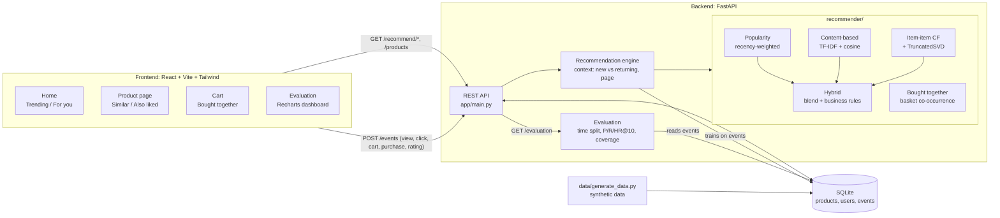

# 🛍️ ShopSmart: E-commerce Recommendation System

A working full-stack demo of an online shop that recommends products using four methods:
**Popularity**, **Content-based filtering**, **Collaborative filtering** and a **Hybrid** that
combines them with business rules. Every recommendation comes with a short reason, such as
*"Because you viewed Voltix Pro Smartphone"* or *"Popular in Electronics"*.

**Features:** personalised recommendations · similar products · customers also liked ·
frequently bought together (product page and cart) · recently viewed · based on your purchases ·
an **Admin page** to tune the hybrid's weights and business rules without touching code.

| Part | Technology |
|---|---|
| Backend | Python 3.11+, FastAPI, SQLite via SQLAlchemy |
| Machine learning | pandas, NumPy, SciPy, scikit-learn (TF-IDF, cosine similarity, TruncatedSVD) |
| Frontend | React (Vite), Tailwind CSS, Recharts |

Everything runs locally. There are no paid APIs and no Docker.

Product images are photos from the free [DummyJSON](https://dummyjson.com) test data, downloaded once with `python -m data.fetch_images` and served from `backend/data/images/`; product types without a matching photo show a line-icon tile.

---

## 1. Quick start (Windows)

You need **Python 3.11 or newer** (`python --version`) and **Node.js 18 or newer** (`node --version`).

### Terminal 1: backend

```powershell
cd backend
python -m venv .venv
.\.venv\Scripts\activate
pip install -r requirements.txt

python -m data.generate_data        # creates data\shop.db (500 products, 300 users, ~20,000 events)
python -m evaluation.evaluate       # computes the metrics and saves evaluation\results.json
uvicorn app.main:app --reload       # API on http://localhost:8000  (docs: http://localhost:8000/docs)
```

> If PowerShell blocks `activate`, run this once:
> `Set-ExecutionPolicy -Scope CurrentUser RemoteSigned`
> You can also skip activation and use `.\.venv\Scripts\python -m ...` directly.

### Terminal 2: frontend

```powershell
cd frontend
npm install
npm run dev                         # opens on http://localhost:5173
```

### Run the tests

```powershell
cd backend
.\.venv\Scripts\activate
pytest -v
```

*(macOS/Linux: use `source .venv/bin/activate` instead of `.\.venv\Scripts\activate`.)*

**Tips**
- If `shop.db` is missing, the API generates it automatically on startup.
- To start from fresh data, stop the API and run `python -m data.generate_data` again. This also clears events logged from the website.
- The frontend expects the API at `http://localhost:8000`. To change this, copy `frontend/.env.example` to `frontend/.env` and edit `VITE_API_URL`.

---

## 2. Demo script for the presentation

1. **Cold start.** Open the Home page. You are a *new visitor*, so you see **Trending now** and **Best sellers** (popularity).
2. **Learning live.** Open 2 or 3 products and click *Add to cart*. Each action is saved as an event in SQLite. Go back to Home: the context changes to *returning user* and **Recommended for you** appears.
3. **Returning users.** Pick a demo shopper in the top-right selector (for example *"Likes Electronics & Office Supplies"*). Their list is personalised, and every item shows a reason.
   Returning users also see **Recently viewed** and **Based on your purchases**.
4. **Product page.** **Frequently bought together** (hidden when a product has no basket data yet), **Similar products** from content-based filtering, and **Customers who liked this also liked** from collaborative filtering.
5. **Cart page.** **Frequently bought together**, for example Smartphone → Phone Case, or Notebook → Gel Pen Set.
6. **Evaluation page.** A bar chart comparing all methods, with a short explanation of each metric.
7. **Admin page.** Move the blend sliders or set *Max products per category* to 1, save, and reload Home: the list changes immediately. *Run test* compares your saved rules with the defaults on past data.

---

## 3. Architecture



### The pipeline: Collect → Represent → Generate candidates → Rank → Measure

| Step | What happens | Where in the code |
|---|---|---|
| **1. Collect** | Synthetic history is generated, and live events (view, click, add_to_cart, purchase, rating) from the website are saved through `POST /events`. | `backend/data/generate_data.py`, `backend/app/main.py` |
| **2. Represent** | Products become **TF-IDF vectors**. Users and items become a **user × item matrix** with implicit weights (view=1, click=2, cart=3, purchase=5). Each user becomes a **history vector**. | `backend/recommender/base.py`, `content_based.py` |
| **3. Generate candidates** | Each method scores all products, and the top 100 from each method are merged into a candidate set. | `backend/recommender/hybrid.py` |
| **4. Rank** | Scores are normalised to 0–1, blended with weights, and filtered by business rules. Each item gets a reason. | `backend/recommender/hybrid.py`, `engine.py` |
| **5. Measure** | Time-based split, then Precision@10, Recall@10, Hit rate@10 and coverage for every method. | `backend/evaluation/evaluate.py` |

### Folder structure

```
ecommerce-recommendation-system/
├── backend/
│   ├── app/                 # FastAPI: database.py, models.py, schemas.py, main.py, images.py
│   ├── data/                # generate_data.py → shop.db
│   ├── recommender/         # base.py, popularity.py, content_based.py, collaborative.py, hybrid.py, engine.py, settings.py
│   ├── evaluation/          # evaluate.py → results.json
│   ├── tests/               # pytest tests (recommenders + API)
│   └── requirements.txt
├── frontend/
│   └── src/                 # api.js, store.jsx, components/, pages/ (Home, Shop, ProductPage, CartPage, Evaluation, Admin)
└── README.md
```

---

## 4. The data

`generate_data.py` builds a realistic, **reproducible** (fixed random seed) dataset:

- **500 products** in **10 categories** (Electronics, Fashion, Home & Kitchen, Books, Sports & Outdoors, Beauty, Toys & Games, Grocery, Office Supplies, Pet Supplies). Each product has a name, brand, price, description, tags, stock and a placeholder image. About 5% are out of stock.
- **300 users**. Each one has hidden preferences: 1–3 favourite categories, a price band (budget, mid or premium) and a favourite style. **8 demo users** have clear profiles for the presentation.
- **~20,000 events** over 180 days, generated as shopping sessions:
  - users mostly browse their favourite categories, with some exploration
  - popularity has a **long tail**: a few hit products and many rarely seen ones
  - some products launched recently and are **trending**
  - a funnel: view → click → add to cart → purchase → rating
  - **complementary products** are often bought together (phone + case, coffee maker + beans)

The recommenders **never read** these hidden preferences. They learn only from the events, as a real shop would.

---

## 5. The algorithms (simple explanations for the viva)

### 5.1 Popularity: "Trending now"
- **Idea:** recommend what many people are interacting with **right now**.
- **How:** every event adds points to its product (view 1, click 2, cart 3, purchase 5). Older events count less: an event loses half its value every **14 days** (exponential time decay, `score = weight × 0.5^(age / 14 days)`).
- **When it is used:** for **new visitors** (the *cold-start* problem: we know nothing about them yet), and as one ingredient of the hybrid.
- **Pros and cons:** simple and always works, but it is not personal and shows the same few items to everyone (low coverage).

### 5.2 Content-based filtering: "Similar products"
- **Idea:** if you like a product, you will probably like products that *look* similar.
- **How:**
  1. Each product becomes text: name + description + tags + category.
  2. **TF-IDF** (Term Frequency × Inverse Document Frequency) turns the text into a vector. Words that appear often in *this* product but rarely in the whole shop (e.g. "noise-cancelling") get a high weight. Common words like "great" get a low weight.
  3. **Cosine similarity** measures the angle between two vectors: 1 means identical direction (very similar), 0 means nothing in common.
- **For a user:** add up each product's similarity to the items the user interacted with, weighted by how strongly they interacted.
- **Pros and cons:** works for **brand-new products** with no history, and the reasons are easy to explain ("Similar features: bluetooth, audio"). However, it only recommends "more of the same" and cannot discover surprising connections.

### 5.3 Collaborative filtering: "Customers who liked this also liked"
- **Idea:** learn from the **behaviour of other shoppers**, not from product text.
- **User × item matrix:** one row per user and one column per product. Each cell is `log(1 + sum of event weights)` (view=1, click=2, cart=3, purchase=5; ratings add +3 for 5 stars and −3 for 1 star).
- **Item-item similarity:** two products are similar when the **same users** interacted with both, measured by cosine similarity between their matrix columns. We keep only the **50 nearest neighbours** of each product and *shrink* similarities that rest on very few shared users, which reduces noise.
- **For a user:** `score(product) = Σ similarity(product, item the user liked) × strength of that interaction`.
- **Matrix factorisation (TruncatedSVD):** compresses the matrix into **32 hidden "taste" factors**, for example "budget tech fan". A user and a product match when their factors point in the same direction. New users are "folded in" by projecting their history onto the factors.
- **Pros and cons:** finds connections that text can't (people who buy running shoes also buy protein powder). The weakness is that it needs data, so it can't help brand-new users or products (cold start).

### 5.4 Frequently bought together (cart page)
Counts how often two products end up in the **same shopping session's basket** (add to cart or purchase). For the items in your cart, it suggests the products with the highest co-occurrence counts. Fallbacks are item-item CF and then popularity.

### 5.5 Hybrid: "Recommended for you"
1. **Generate candidates:** take the top 100 products from each method (popularity, content, item-CF, SVD).
2. **Normalise:** scale each method's scores to 0–1 (min-max) so they can be compared.
3. **Blend:** `0.35 × item-CF + 0.20 × SVD + 0.25 × content + 0.20 × popularity`.
4. **Business rules:**
   - ❌ remove **out-of-stock** items
   - ❌ remove items the user **already bought**
   - 💰 **prefer the user's usual price range.** We compare the product's *relative* price inside its category with the user's average, and products far from it lose up to 30% of their score. A relative price is needed because a cheap laptop still costs more than expensive pasta.
   - 🌈 **diversity:** at most **3 items from the same category** in the top 10
5. **Explain:** the method that contributed most to an item's score decides its reason. For example, *"Customers who liked X also liked this"* comes from CF and *"Because you viewed X"* comes from content.

### 5.6 Context: which list is shown when?
| Situation | What we show |
|---|---|
| New visitor (< 3 interactions) | Trending now, *Popular in &lt;category you are browsing&gt;*, Best sellers, Recently viewed |
| Returning user | Recommended for you (hybrid), Recently viewed, Based on your purchases, Inspired by your last viewed item, Trending now |
| Product page | Frequently bought together, Similar products (content), Customers also liked (item-CF) |
| Cart page | Frequently bought together |

- **Recently viewed** lists products the user interacted with but did not buy, newest first. They are not repeated in the personalised rows below.
- **Based on your purchases** runs the hybrid on the user's purchases only, so its reasons read *"Because you bought X"*.
- The "3 interactions" threshold and both extra rows can be changed on the Admin page (section 5.7).

Models retrain automatically, at most every 3 seconds, after new events arrive. Each user's own history is always read fresh from the database, so recommendations react immediately to what you do on the site.

### 5.7 Admin page: managing the rules
The hybrid's settings live in `recommender/settings.py` and are stored as JSON in the `app_settings` table, so they survive restarts. Regenerating the data resets them to the defaults.

| Setting | Default | Effect |
|---|---|---|
| Blend weights | 0.35 / 0.20 / 0.25 / 0.20 | How much item-CF, SVD, content and popularity count. Only the ratio matters. |
| Max products per category | 3 | Diversity rule (10 = no limit) |
| Price-range preference | 0.30 | Max share of score lost for being far from the user's usual price range (0 = off) |
| Hide out-of-stock | on | |
| Hide already bought | on | Turn off for repeat-purchase shops (groceries, pet food) |
| Interactions before personalising | 3 | Cold-start threshold |
| Show Recently viewed / Based on your purchases | on | Home page rows |

Saving applies the rules to the next request without retraining. **Run test** calls `POST /admin/evaluate`, which adds a *Hybrid with admin settings* row to the offline evaluation (not saved to `results.json`).

> The admin endpoints have **no login**. That is fine for this local demo, but a real shop must protect them (an admin session or API key) before going live.

---

## 6. Evaluation

**Method (`python -m evaluation.evaluate`):**
1. **Time-based split.** For each user with at least 5 events, their **latest 20%** of events go to the test set and the rest go to training. This mirrors real life: we learn from the past and predict the future. A random split would let the model "peek" at the future.
2. All models are trained **only on training data**.
3. For each test user we recommend 10 products they have **not** interacted with in training. *Relevant* products are the new products they interacted with in the test period.
4. Metrics, averaged over users:
   - **Precision@10** = relevant items in the top 10 ÷ 10
   - **Recall@10** = relevant items in the top 10 ÷ all relevant items
   - **Hit rate@10** = share of users with at least one relevant item in the top 10
   - **Coverage** = share of the catalogue recommended to at least one user

**Results on the generated data (seed 42, 273 test users):**

| Method | Precision@10 | Recall@10 | Hit rate@10 | Coverage |
|---|---|---|---|---|
| Random (baseline) | 0.0048 | 0.0131 | 0.0476 | 99.4% |
| Popularity | 0.0355 | 0.1081 | 0.2747 | 5.4% |
| Content-based | 0.0396 | 0.1332 | 0.3150 | 84.2% |
| Collaborative (item-item) | 0.0670 | **0.2306** | 0.4908 | 40.2% |
| Matrix factorisation (SVD) | 0.0582 | 0.2190 | 0.4725 | 53.8% |
| **Hybrid** | **0.0678** | 0.2198 | **0.5092** | 40.8% |
| Hybrid without diversity rule | 0.0762 | 0.2597 | 0.5348 | 51.6% |

**How to read it**
- All methods beat random by a wide margin, so they learned real patterns.
- **Popularity** is a good cold-start fallback but covers only about 5% of the catalogue.
- **Collaborative filtering** is the strongest single method, because behaviour says more than product text.
- **Content-based** has the best coverage and works for new products.
- **Hybrid** gets the best precision and hit rate (half of all users get at least one correct product in their top 10).
- **Trade-off:** the *"max 3 per category"* diversity rule costs some accuracy. Without it, recall rises from 0.22 to 0.26, because users mostly shop in their 1–3 favourite categories. We keep it on purpose, since a more varied list helps discovery and avoids filter bubbles. The price-range rule, on the other hand, *improves* accuracy.
- Precision values look small because each user has only a few new relevant products among 500. Even a perfect model could not reach 100%.
- During evaluation the out-of-stock filter is switched off, because stock is today's value and we are replaying the past.

The numbers are shown on the **Evaluation** page and can be recomputed there (*Re-run evaluation*) or through `GET /evaluation?refresh=true`.

---

## 7. API reference

Interactive docs (Swagger UI): **http://localhost:8000/docs**

| Method | Endpoint | Description |
|---|---|---|
| GET | `/products?category=&q=&limit=&offset=` | Product list with filter, search and paging |
| GET | `/products/{id}` | One product, with average rating |
| GET | `/categories` | Categories with product counts |
| GET | `/users` | Demo users for the selector |
| POST | `/users` | Create a new visitor (for showing cold start) |
| POST | `/events` | Log `{user_id, product_id, event_type, rating?, session_id?}` |
| GET | `/recommend/home?user_id=` | Trending for new visitors, "Recommended for you" for returning users |
| GET | `/recommend/similar/{product_id}` | Content-based similar products |
| GET | `/recommend/also-liked/{product_id}` | Item-item collaborative filtering |
| GET | `/recommend/bought-together/{product_id}` | Frequently bought together for one product (empty if no basket data) |
| GET | `/recommend/cart?user_id=&product_ids=1,2` | Frequently bought together (cart is rebuilt from events if `product_ids` is omitted) |
| GET | `/evaluation?refresh=false` | Saved evaluation results (`refresh=true` re-runs it) |
| GET | `/images/{id}.svg` | Generated placeholder product image (works offline) |
| GET | `/admin/settings` | Current and default recommendation rules |
| PUT | `/admin/settings` | Save new rules (validated; applied immediately) |
| POST | `/admin/settings/reset` | Restore the default rules |
| POST | `/admin/evaluate` | Score the saved rules against the default hybrid |
| GET | `/admin/stats` | Product, user and event counts for the Admin page |

Every recommendation response has the form `{product, score, reason, method}`.

---

## 8. Tests

`backend/tests/` contains 19 pytest tests:
- **`test_recommenders.py`** uses a tiny hand-made shop with known correct answers. It tests event weights, recency in popularity, content similarity, item-CF co-interactions, frequently bought together, the hybrid business rules (bought, out of stock, diversity), personalisation, the time-based split and the metric formulas.
- **`test_api.py`** tests the full API on a *temporary* database (your real `shop.db` is never touched), including a new visitor becoming a returning user after 3 events, the Recently viewed and Based on your purchases rows, product-page bought together, and admin settings changing the recommendations.

---

## 9. Possible extensions
- Tune the hybrid weights on a separate validation split (grid search).
- Add ranking-aware metrics (NDCG, MAP) and novelty/diversity metrics.
- Session-based models (e.g. "next item" prediction) or implicit ALS.
- An A/B-test simulation comparing methods by click-through rate on the live site.
